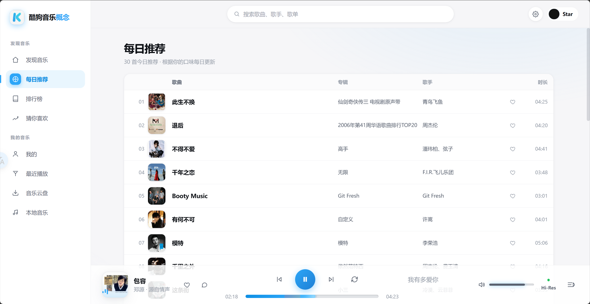

#  Kugoumusic-web

<div align="center">

**酷狗音乐概念版 · 第三方全栈客户端**

Go 后端 + Vue3 前端，单二进制部署，开箱即用

**参考项目**：[MoeKoeMusic](https://github.com/MoeKoeMusic/MoeKoeMusic) · [KuGouMusicApi](https://github.com/MakcRe/KuGouMusicApi)

[](https://go.dev/)
[](https://vuejs.org/)
[](https://vitejs.dev/)
[](LICENSE)

</div>

---

<div align="center">
  
</div>

## 🏗️ 技术栈

| 层 | 技术 |
|---|---|
| 后端 | Go 1.26, net/http, crypto (AES/RSA) |
| 前端 | Vue 3 `<script setup>` SFC, Pinia, Vue Router, Axios |
| 构建 | Vite, `//go:embed` 嵌入前端产物 |
| 协议 | 酷狗 Android/Web 签名算法, KRC 歌词解码, RSA 裸加密 |
| 设计 | CSS 变量, 玻璃质感, 深色/浅色主题 |

## 📂 项目结构

```
├── main.go              # 入口 + 路由 + HTTP 服务
├── api/                 # 后端 API 模块（19 个文件）
│   ├── request.go       # 请求签名、平台切换、HTTP 客户端
│   ├── crypto.go        # AES/RSA 加密工具
│   ├── search.go        # 搜索（建议/热搜/综合/分类型）
│   ├── song.go          # 播放地址、歌词（KRC 解码）
│   ├── playlist.go      # 歌单（详情/歌曲/标签/推荐/每日推荐）
│   ├── social.go        # 歌单管理 + 评论（增删歌/创建删除/评论增删查）
│   ├── album.go         # 专辑（详情/歌曲）
│   ├── artist.go        # 歌手（详情/歌曲/专辑/热门/列表/关注）
│   ├── rank.go          # 排行榜（榜单列表/歌曲）
│   ├── user.go          # 用户信息/VIP/关注
│   ├── auth.go          # 登录（扫码/手机/密码）
│   ├── discover.go      # 发现页（新歌/新专/推荐卡片）
│   └── types.go         # 公共类型定义
├── middleware/           # 中间件（CORS/日志）
├── web/                 # 前端项目
│   ├── src/
│   │   ├── views/       # 页面（Home/Me/Search/Ranking/Playlist/Album/Artist）
│   │   ├── components/  # 通用组件（Sidebar/TopBar/PlayerBar/CommentModal 等）
│   │   ├── stores/      # Pinia stores（player/auth）
│   │   ├── utils/       # API 封装（api.js/auth.js）
│   │   └── assets/      # 静态资源 + 全局样式
│   └── dist/            # 构建产物（go embed）
├── TASKS.md             # 功能对齐清单
└── AGENTS.md            # 开发备忘（签名/接口迁移/坑位记录）
```

## 🚀 快速开始

### 前置要求

- Go 1.26+
- Node.js 18+（仅开发/构建前端时需要）

### 构建

```bash
# 1. 构建前端
cd web && npm install && npm run build

# 2. 构建后端（前端产物嵌入二进制）
cd .. && go build -o vibe-server .
```

### 运行

```bash
# 概念版（默认）
./vibe-server

# 自定义端口（默认 :8080）
PORT=3000 ./vibe-server
```

浏览器打开 `http://localhost:8080`

## 🐳 Docker 部署

### 本地构建镜像

```bash
cd web && npm install && npm run build   # 构建前端
cd .. && docker build -t vibe-server .    # 多阶段构建（node → go → alpine）
docker compose up -d
```

容器内 `/data` 为持久卷（设备标识 `.device-guid`），容器重建/重启后保持同一设备身份，登录 token 不失效。

### 常用命令

```bash
docker compose up -d         # 构建并启动（后台）
docker compose down          # 停止并删除容器（持久卷保留）
docker compose restart       # 重启
docker compose logs -f       # 查看日志
docker volume ls             # 数据卷列表
```
## ⚠️ 免责声明

本项目仅供学习和研究使用，请勿用于商业用途。API 版权归酷狗音乐所有。

## 📄 License

Apache-2.0
